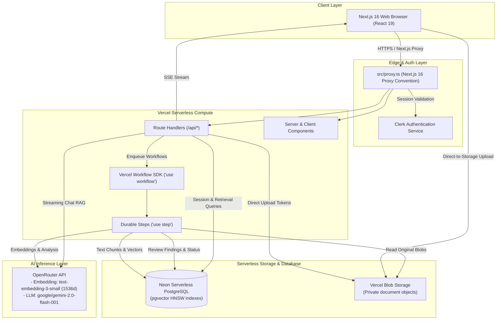

# IntelliBooks — Architecture Reference

IntelliBooks is an enterprise-grade AI contract review assistant designed for high accuracy, verifiable analysis, and strict tenant isolation. It is engineered specifically for serverless deployment on Vercel, utilizing Neon PostgreSQL with pgvector, Drizzle ORM, Clerk authentication, private Vercel Blob storage, OpenRouter for LLM/embedding inference, and the Vercel Workflow SDK for durable asynchronous job execution.

> **Zero-Docker Guarantee**: The IntelliBooks architecture does not use Docker, Docker Compose, Redis, BullMQ, or containerized databases in development, testing, CI, or production. All services run natively on managed serverless infrastructure.

---

## High-Level System Architecture

---

## Architectural Pillars

### 1. Next.js 16 App Router & Edge Authentication
- **Framework**: Next.js 16.0.7 with React 19 and Tailwind CSS.
- **Proxy Convention**: Uses `src/proxy.ts` (Next.js 16 convention replacing legacy `middleware.ts`) invoking `clerkMiddleware()` for session cookie verification.
- **Server-Side Authorization**: Every protected Route Handler and Server Action independently validates `userId` via `@clerk/nextjs/server` `auth()`. Defense-in-depth ensures client-provided claims or IDs are never trusted.

### 2. Neon Serverless PostgreSQL & Drizzle ORM
- **Database Engine**: Neon PostgreSQL with native connection pooling (`@neondatabase/serverless`).
- **Vector Search**: PostgreSQL `pgvector` extension enabled with 1536-dimensional cosine distance HNSW index (`vector_cosine_ops`) on `document_chunks.embedding`.
- **ORM & Migrations**: Drizzle ORM (`drizzle-orm` and `drizzle-kit`) with pure TypeScript schema definitions located in `src/db/schema/`.
- **Relational Integrity**: Foreign key constraints with `ON DELETE CASCADE` ensure contract deletion cleanly removes all associated blobs metadata, chunks, reviews, findings, chat sessions, and messages.

### 3. Private Vercel Blob Storage
- **Direct-to-Blob Uploads**: Browser requests a short-lived client upload token from `/api/upload` and transmits documents directly to private Vercel Blob storage, preventing large payloads from exhausting serverless execution limits.
- **Zero Public Exposure**: Document blobs are created with `access: 'private'`, accessible only via signed server-side credentials.
- **Verification Gate**: The upload callback `/api/upload/complete` cryptographically and structurally validates document magic bytes, MIME types, and file size limits (20 MB maximum) before storing contract records.

### 4. Vercel Workflow SDK for Durable Execution
- **Durable Step Execution**: Long-running document extraction and review analysis run through the Vercel Workflow SDK (`workflow` package) using `"use workflow"` and `"use step"` execution primitives.
- **Idempotency & Concurrency**: Atomic database transaction checks (`contracts.processingStatus`, `contract_reviews.status`) prevent duplicate workflow runs. Concurrent workflow requests for the same contract return existing running instances.
- **Fault-Tolerant Step Boundaries**: Step failures can be retried independently without re-running successful document extraction or chunk embedding steps.
- **No Redis / BullMQ**: Background jobs run without daemon processes, message brokers, or container runners.

### 5. Document Processing Pipeline
- **Dual-Engine Extraction**:
  - **PDF**: `pdf-parse` extracts text page-by-page, recording exact page numbers and character offsets. Image-only/scanned PDFs are detected and flagged.
  - **DOCX**: `mammoth` extracts headings, structured paragraphs, and tabular data, preserving document hierarchy.
  - **TXT**: Robust UTF-8 decoding with fallback encoding handling and paragraph preservation.
- **Recursive Semantic Chunking**: Documents are split into 1,000-character chunks with 200-character sliding overlaps, bound to strict character offsets and page/heading locations.
- **Batch Embedding Generation**: Embeddings are generated in parallel batches using OpenRouter's `text-embedding-3-small` (1536-dimensional).

### 6. Review Analysis & Verbatim Quote Verification Gate
- **Checklist Engine**: Analyzes contracts across 8 core categories:
  1. `parties`: Contracting parties and entities
  2. `start_date_term`: Effective date, term duration, and expiration
  3. `payment_terms`: Invoicing, payment schedule, currency, and penalties
  4. `termination`: Termination for cause, convenience, and notice period
  5. `limitation_of_liability`: Liability caps, consequential damages exclusions
  6. `confidentiality`: Non-disclosure obligations, definition of confidential info
  7. `governing_law`: Jurisdiction, choice of law, and dispute resolution
  8. `auto_renewal`: Renewal mechanisms, opt-out notice windows
- **Exhaustive Candidate Coverage**: For each category, hybrid semantic search retrieves relevant chunks. If coverage falls below threshold, exhaustive fallback scanning is executed before any clause is marked `not_found`.
- **Verbatim Verification Gate**: Every AI-generated quote is verified via case-normalized exact substring matching against the raw extracted contract text. Fabricated or hallucinated quotes cause the finding to downgrade to `unclear` or null quote.

### 7. Contract Chat & Streaming RAG
- **Session Management**: Multi-session contract Q&A stored in `chat_sessions` and `chat_messages`.
- **Tenant-Scoped Vector Retrieval**: Chat queries are embedded and matched against the contract's chunks via cosine similarity in pgvector, strictly scoped to `contract_id` and `user_id`.
- **Prompt Injection Defense**: Contract context is isolated inside `<contract_context>` XML delimiters with explicit instructions forbidding prompt tampering.
- **Server-Sent Events (SSE)**: Streams generated responses in real-time (`event: token`, `event: context`, `event: done`, `event: error`).
